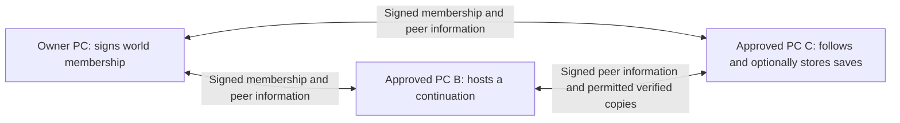

# Peer shared worlds delivery

## Authorized behavior

The owner approved implementation on 2026-10-16. A world retains its original
trusted identity as hosting moves between approved PCs. Members can follow the
world without storing a save. Approved receivers opt in to local storage; hosting,
forwarding saves, voting and managing access remain distinct permissions.

An eligible person can explicitly recover alone from their newest complete,
verified available copy. There is no maximum save age. The original Host need not
be offline, approve the recovery again, or prove its game stopped. A reachable
companion with an unusable game is a valid reason to offer manual recovery.
Recovery creates a separate continuation: it does not replace another running
world, silently choose the group's default, or authorize remote Stop.

Competing sessions may continue. Each records its exact parent save, signer and
session identity. Members learn signed announcements through reachable approved
peers; disconnected members catch up later. A returning original Host has no
automatic priority. Group default selection and owner policy remain explicit;
both histories survive. Never infer a winner from a wall-clock timestamp.

The newest safe snapshot should be captured and replicated promptly. Partial or
unverified bytes never displace a verified copy. Real-game capture must use the
reviewed game-specific immutable snapshot and retain its completion, transfer,
load, change and restart acceptance boundaries. A scheduler or hash is not real
game acceptance. No application or game is started automatically by peer sync.

## Member and Host flow

Once B and C have trusted membership and reachable cached contacts, that exchange
continues with O offline. A single authorized PC can also recover from its already
verified local copy. Two reachable PCs enable replication and catchup; they are
not a recovery quorum. Each save remains signed by its authorized source, and
each PC enforces the freshest trusted membership it has learned.

| Action | Required authority or evidence |
| --- | --- |
| Follow signed addresses and sessions | Active enrolled world membership |
| Store world files | Receive and local receiving consent |
| Forward received files | Receive, Reshare, consent and enabled inbound exchange |
| Prepare and manually start recovery | Receive, Eligible host, consent, exact verified source and local setup checks |
| Select the group default | Owner or current Manage sharing; explicit signed session choice |
| Publish real live snapshots | Current source authority and installation-specific six-stage acceptance |

On Join, open Shared worlds to review known sessions, contact codes, conflicts and
locally available histories. Selecting a new Host creates or verifies this PC's
own connection credential. Selecting recovery opens the exact chosen history;
the source world ID, branch ID and new local hosting profile remain separate.
The owner PC can recover a peer history through the same guarded local setup
without pairing to itself. A restored setup can be reopened and finished later.

Private live tests are separate from playable copies. Capture, sealed copy and
the distinct receiver's signed receipt are app evidence. The owner records load,
a recognizable saved change and graceful restart in order. Stale tests remain
history and cannot authorize confirmations or real publication.

## Implementation ownership

- Coordinator: integration, fixed authenticated transport, membership/following,
  UI, delivery evidence and serialized commits.
- `gpt-6.1-sol` / maximum reasoning subagent: solo recovery and separate-copy paths.
- `gpt-6.1-sol` / maximum reasoning subagent: signed peer state and protected store.
- `gpt-6.1-sol` / maximum reasoning subagent: authenticated contact bootstrap,
  offline-owner catchup and immutable reads during capture.
- Three `gpt-6.1-sol` / maximum reasoning Codex CLI workers: save freshness and
  safe capture scheduling, installed live-save acceptance, and recovery branch
  live capture integration.

Workers own separate files. Shared builds, test runners, UI bundles and commits
are serialized by the coordinator. No worker may launch apps, browsers, fixtures,
game processes, dialogs or listeners on the owner's active desktop.

## Delivery slices and status

| Slice | Status |
| --- | --- |
| Solo recovery without Host-loss, votes or another-PC route proof | Integrated; source/synthetic validation |
| Stable world groups, signed peer directory and durable session/branch metadata | Integrated; source/synthetic validation |
| Follow membership without save consent; authenticated peer metadata catch-up | Integrated; source/synthetic validation |
| Peer save seeding, verification, resumable transfer and replica health | Integrated; source/synthetic validation |
| Signed current-session announcements, successor enrollment and grouped Join UX | Source integrated; component checks passed |
| Repeated recovery descendants, owner return and explicit default resolution | Integrated; source/synthetic validation |
| Freshest safe copies, automatic capture scheduling and visible acceptance | Integrated; installation acceptance required for real capture |
| Signed contact bootstrap, mixed versions and storage limits | Integrated; source/synthetic validation |
| Revocation, expiry and successor-local restriction boundaries | Integrated; typed decisions and immediate local fences |
| Source/synthetic and code-only validation | PASS 41 groups; locked solution build, TypeScript, lint and isolation checks |
| Component validation | PASS 1007 tests across 83 files |
| UI bundle and app with bundled assets | PASS; app build zero warnings/errors |
| Separate-PC/network, real game/save/restart and rendered/native acceptance | External acceptance required |

## Integration evidence

The coordinator's component checks use JSDOM and mocked APIs; no browser or app
was launched. An intermediate full run exposed an asynchronous navigation test
that did not await its mode change. Its harness now awaits completion, without
weakening its assertions; all 1004 tests then passed. Three final world-level
consent cases passed in the focused 37-test UI run. The final full run passed
all 1007 tests across 83 files. Final lint and `npm run build` passed. Vite retains
the existing chunk-size advisory: the main minified JavaScript chunk is about
1,016 kB (277 kB gzip). No runtime performance or rendered viewport claim follows
from these component results.

Three Codex CLI source workers and bounded subagents used `gpt-6.1-sol` with maximum
reasoning. Workers did not build, run tests, open apps/listeners, or commit.
The installation-acceptance CLI completed its source handoff but its CLI process
returned exit 1; this is not recorded as a passing build or test. Coordinator
compilation and checks are the acceptance evidence for its files.

The private test receiver has a separate signed artifact kind, protected completed
marker and stable per-receiver receipt. Native namespace/file leases protect
verification through commit; uncommitted, partial and corrupt copies stay private.
Owner-device receipts use a private schema that canonical receipt verification
rejects. Receiving consent is distinct from enabling an inbound listener.

Recovery source selection resolves an explicitly selected signed history to its
verified local payload and retains that exact hash through Prepare and Declare.
Missing or ambiguous heads never silently select another history. Branch-local
profile IDs remain separate from original world IDs and per-Host credentials.

Branch live capture uses the same installation-scoped acceptance as the original
source. Protected ownership binds the local recovery profile, original world,
branch, member and distinct hosting key. Accepted branches can schedule safe
captures without enabling canonical sharing. Publication, unchanged-copy reuse,
interruption and reconciliation operate on that exact branch. Private schema-2
test artifacts remain separate from playable saves and canonical receipts.

The first final code-only run compiled the solution with zero warnings/errors,
then found a corrupt-head fallback defect and a revocation fixture setup gap.
Freshness now verifies signed ancestry without requiring the newest payload to
be intact before checking predecessors. The revocation fixture now supplies the
owner-signed removal to the receiving PC before asserting immediate local denial;
a remote peer's revision acknowledgment alone never proves revocation.

The corrected `scripts/verify-code-only.ps1` run passed all 41 source/synthetic
groups, pinned-tool/version checks, locked restore, TypeScript, lint, solution
compilation with zero warnings/errors, whitespace and desktop diagnostic isolation.
The synthetic source-symbolic-link subcase was skipped because this Windows
account cannot create symbolic links. This gate compiled fixture/check projects
but executed only the isolated FeatureChecks runner; it launched no app, game,
fixture, browser, native dialog or listener.

The final `dotnet build src/TogetherServer/TogetherServer.csproj -c Release
--no-restore` passed with the newly generated bundled UI, zero warnings and zero
errors. This is a build, not a packaged installation, app launch or release.
Production app data and the owner's running application were not used for testing.

## Production build handoff: 2026-10-17

At the owner's request, published the production Windows x64 self-contained,
compressed single-file app from `70613a0c0c85b9988523cd31f175cf6a2b26dbc2` to the
ignored `local-data/peer-worlds-production-20261017-70613a0/TogetherServer.exe`.
Locked UI install with install scripts disabled, UI build, locked .NET restore
and Release publish passed. Static inspection verified all four current UI files
embedded byte-for-byte in the publish input assembly and the executable's x64 GUI
header. Numeric file version is `0.3.2.0`; product version contains the exact source
commit. The artifact is 65,921,911 bytes and Authenticode reports `NotSigned`.

SHA-256: `6514d81fe46d74362f5be494ef84fe24d8c249bbf241b31033f4fbba46f40ad3`.
The artifact folder includes its checksum and JSON build/UI evidence. No app was
loaded or launched, installed, or replaced; production data stayed untouched.
Real-game, Friend-PC/network and rendered/native acceptance remain pending.

## Operational limits

Peer routes require a reachable pinned literal-IP HTTPS origin. The app does not
configure routers/firewalls or provide relay/NAT traversal. Cached known contacts
allow the original owner to be offline; a brand-new installation still needs its
trusted membership/key backup or explicit enrollment. A contact code cannot
replace lost signing credentials or authorize a new identity.

Signed metadata has explicit per-message and protected-store bounds. Peer payloads,
histories and incomplete evidence are retained; the free-space reserve pauses new
work instead of silently pruning a fork. Automatic peer payload retention settings
and deletion UI are not introduced by this slice.
The current UI refuses multiple heads within one hosting lane until the user
reviews an exact source; a timestamp or version number does not choose it.

## Verification and protected boundaries

Use `scripts/verify-code-only.ps1` and focused pure/synthetic/component checks.
No full release gate, direct legacy process runner, desktop/installer smoke,
browser automation or game tests run on the owner's active desktop. Those gates
require a separate test PC or an explicitly approved unattended Windows session.

Do not access production app data, credentials, logs or worlds. Do not change
public firewall/router/DNS policy, accept game terms, download gated game binaries,
publish a release, or install/replace/launch the owner's running app. Tests use
disposable synthetic state. External acceptance remains unverified until observed.
